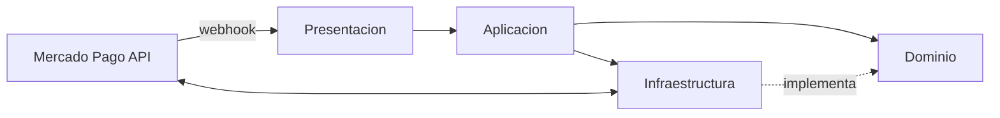
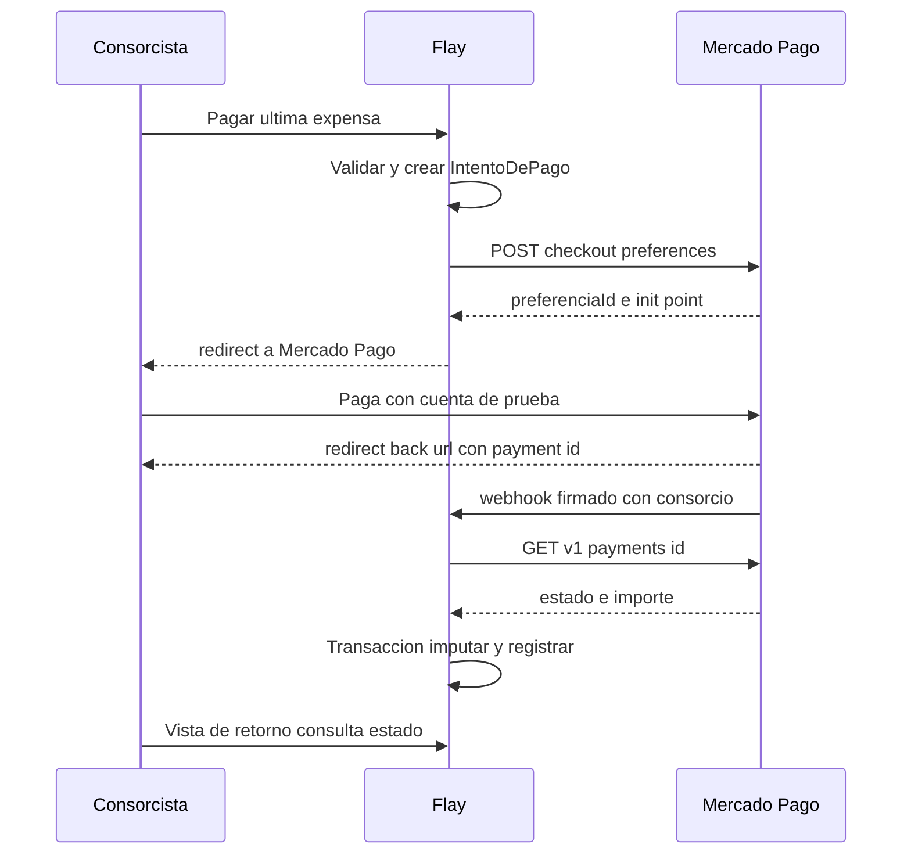

# Diseño — Pago en línea de expensas con Mercado Pago (`RF-28`)

> Diseño validado en sesión de brainstorming el 2026-10-15. Alcance: **solo entorno sandbox** de
> Mercado Pago. Rama prevista: `006-pago-en-linea`. Copia idéntica en
> `specs/006-pago-en-linea/diseno.md`.

## 1. Objetivo y alcance

El consorcista (propietario o inquilino habilitado sobre la unidad) paga su expensa desde Flay con
Mercado Pago. El pago aprobado se registra e imputa automáticamente, con el mismo camino que usa el
registro manual del administrador (`RF-09`, `CU-04`).

**Se incorpora como requerimiento funcional nuevo `RF-28` — Pago en línea de expensas.** Hasta hoy
la "Pasarela de pagos integrada" figuraba entre las funciones excluidas de
`docs/entrega-1/04-alternativas-solucion.md`; este diseño la saca de esa lista (ver § 9).

### Decisiones tomadas

| # | Decisión |
|---|---|
| D-1 | Se paga **una expensa puntual: la última expensa vigente de la unidad**. Ninguna otra se puede pagar en línea. |
| D-2 | Si la última expensa arrastra deuda (`deudaAnterior` + `interesMora`), **pagarla cancela el mes actual y todos los meses adeudados** que arrastra. |
| D-3 | El importe lo fija el servidor (saldo exigible de la última expensa). El usuario no lo edita. |
| D-4 | Al aprobarse, el pago se **imputa automáticamente**. La aprobación se verifica siempre consultando la API de Mercado Pago con el token del servidor; nunca se confía en el contenido del webhook ni de la URL de retorno. |
| D-5 | Las credenciales son **por administradora** (todas sus consorcios cobran en la misma cuenta). |
| D-6 | Las carga un **administrador** habilitado en esa administradora desde una pantalla de configuración. El token se guarda cifrado y nunca vuelve al navegador. |
| D-7 | Modalidad: **Checkout Pro con redirección** (preferencia + `init_point`). No Bricks, no links manuales. |

### Fuera de alcance

- Cuentas productivas (solo sandbox en esta etapa).
- Devoluciones y contracargos: si ocurren, el administrador revierte a mano con el mecanismo
  existente (`PagoImputacion.revertidaEn`).
- Medios de pago diferidos (`ticket`, `atm`: Rapipago, Pago Fácil, cajero): se excluyen en la
  preferencia.
- Pago de expensas que no sean la última, pagos parciales e importes libres.
- `public_key` de Mercado Pago (solo la usaría Checkout Bricks).

## 2. Arquitectura y componentes

Respeta las capas de `docs/entrega-3/12-diseno.md` y el punto de composición
`src/aplicacion/dependencias.ts`.



### Dominio (sin Prisma, sin red)

| Archivo | Responsabilidad |
|---|---|
| `src/dominio/contratos/procesador-pagos.ts` | Interfaz `ProcesadorDePagos` (ver abajo). |
| `src/dominio/liquidacion/imputacion.ts` | `imputar` incorpora la **regla de arrastre** (D-2). **TDD obligatorio.** |
| `src/dominio/pagos/firma-webhook.ts` | Verificación pura de `x-signature` (HMAC-SHA256 sobre `id:<data.id>;request-id:<x-request-id>;ts:<ts>;`) con tolerancia temporal. |

```ts
interface ProcesadorDePagos {
  crearPreferencia(datos: {
    credenciales: CredencialesProcesador
    intentoId: string
    titulo: string
    importe: string // Decimal serializado, nunca number
    urlRetorno: string
    urlNotificacion: string
    venceEn: Date
  }): Promise<{ preferenciaId: string; urlPago: string }>

  consultarPago(datos: {
    credenciales: CredencialesProcesador
    pagoExternoId: string
  }): Promise<{
    estado: 'aprobado' | 'rechazado' | 'pendiente' | 'cancelado'
    importe: string
    referenciaExterna: string | null
    fechaAprobacion: Date | null
  }>
}
```

Tres implementaciones, por simetría con el invariante 5 de `CLAUDE.md`:

1. **Mercado Pago** (`src/infraestructura/pagos/mercado-pago.ts`): `fetch` directo a
   `https://api.mercadopago.com` (`POST /checkout/preferences`, `GET /v1/payments/{id}`). Sin SDK:
   son dos endpoints y no justifican una dependencia.
2. **Determinística** (`src/infraestructura/pagos/procesador-de-prueba.ts`): resultado programable
   (aprobado / rechazado / pendiente / importe distinto) para integración y E2E.
3. **Nula**: no hay procesador configurado; el botón "Pagar" no se muestra.

### Aplicación

| Archivo | Responsabilidad |
|---|---|
| `src/aplicacion/pagos/iniciar-pago-en-linea.ts` | Rol `consorcista` habilitado sobre la unidad. Valida última expensa vigente con saldo > 0 y credenciales presentes. Crea o reutiliza el `IntentoDePago` y pide la preferencia. |
| `src/aplicacion/pagos/confirmar-pago-en-linea.ts` | Disparado por el webhook o por la vista de retorno. Consulta la API, decide la transición del intento e imputa. |
| `src/aplicacion/pagos/registrar.ts` | Se extrae `imputarYRegistrar(tx, datos)` reutilizable: registro manual y pago en línea comparten el mismo camino. |
| `src/aplicacion/administradoras/credenciales-pago.ts` | Guardar / leer (descifrado solo en servidor) / estado enmascarado. Rol `administrador` sobre algún consorcio de la administradora. |

### Infraestructura

| Archivo | Responsabilidad |
|---|---|
| `src/infraestructura/pagos/mercado-pago.ts` | Implementación real del `ProcesadorDePagos`. |
| `src/infraestructura/pagos/procesador-de-prueba.ts` | Implementación determinística. |
| `src/infraestructura/cifrado/aes-gcm.ts` | Cifrado AES-256-GCM con `MP_CLAVE_CIFRADO` (32 bytes, base64). Formato almacenado: `iv.tag.cifrado` en base64. |

`dependencias.ts` expone `PROCESADOR_PAGOS` y `CIFRADOR`, eligiendo la implementación por entorno.

### Presentación

| Ruta | Contenido |
|---|---|
| `consorcios/[consorcio]/expensas/[detalle]` | Botón **"Pagar con Mercado Pago"** solo si es la última expensa vigente, tiene saldo y hay credenciales. Muestra el desglose de lo que cancela (mes actual + meses arrastrados + interés). |
| idem, con `?intento=…&payment_id=…` | Vista de retorno: estado del pago ("Procesando…", "Pago acreditado", "Pago rechazado — reintentar"). |
| `configuracion/pagos` | Carga de credenciales de la administradora. Muestra solo "Configurado ••••1234". |
| `src/app/api/pagos/webhook/route.ts` | Público, sin sesión, firma obligatoria. |

## 3. Modelo de datos

Una migración versionada (invariante 7).

### `MedioDePago`

Se agrega el valor `mercado_pago`. El pago imputado es un `Pago` común: aparece en estado de cuenta,
morosidad, indicadores y exportación sin cambios.

### `CredencialPagoAdministradora` (nueva, **económica**, con disparador de auditoría)

| Campo | Tipo | Nota |
|---|---|---|
| `id` | uuid | |
| `administradoraId` | uuid, **único** | Una credencial por administradora. |
| `accessTokenCifrado` | text | AES-256-GCM. |
| `secretoWebhookCifrado` | text | Clave secreta de firma de la aplicación en Mercado Pago. |
| `ultimosCuatro` | text | Único dato que se muestra. |
| `cargadoPor` | uuid | Usuario que la cargó o reemplazó. |
| `creadoEn`, `actualizadoEn` | timestamptz | |

No lleva `consorcio_id`: se alcanza por la administradora del consorcio en contexto.

### `IntentoDePago` (nueva, **económica**, con disparador de auditoría y `consorcio_id`)

| Campo | Tipo | Nota |
|---|---|---|
| `id` | uuid | Es el `external_reference` de la preferencia. |
| `consorcioId` | uuid | Aislado por la extensión (RN-12). |
| `unidadId` | uuid | |
| `detalleLiquidacionId` | uuid | Última expensa al iniciar. **Informativo**: la imputación se decide al confirmar. |
| `importe` | `Decimal(14,2)` | Saldo exigible al iniciar, fijado por el servidor. |
| `estado` | enum `EstadoIntentoPago` | `iniciado`, `aprobado`, `rechazado`, `vencido`. |
| `preferenciaId` | text | |
| `urlPago` | text | Para reutilizar el intento vigente. |
| `pagoExternoId` | text, **único** (parcial, no nulo) | Id del pago en Mercado Pago. |
| `pagoId` | uuid, FK `Pago`, **único** | Un intento genera como máximo un pago. |
| `iniciadoPor` | uuid | |
| `venceEn` | timestamptz | 24 h (`expiration_date_to` de la preferencia). |
| `creadoEn`, `actualizadoEn` | timestamptz | |

Índices:

- `UNIQUE (detalle_liquidacion_id) WHERE estado = 'iniciado'` — un único intento vivo por expensa.
- `UNIQUE (pago_externo_id) WHERE pago_externo_id IS NOT NULL`.
- `UNIQUE (pago_id) WHERE pago_id IS NOT NULL`.

### Webhook sin romper el aislamiento

La `notification_url` de cada preferencia es
`${URL_PUBLICA}/api/pagos/webhook?consorcio=<consorcioId>`. El handler abre el cliente aislado **de
ese consorcio**, resuelve la credencial por consorcio → administradora y busca el intento por el
`external_reference` que devuelve la API. Si el intento no pertenece a ese consorcio, el aislamiento
no lo encuentra y la notificación se descarta. **No se agrega ninguna consulta a la lista blanca de
`filtro-unico.spec.ts`.**

## 4. Regla de arrastre en la imputación (D-2)

Hoy, al liquidar, `totalUnidad` de la nueva expensa ya incluye `deudaAnterior` (saldo impago de las
liquidaciones vigentes previas) e `interesMora`, pero los detalles anteriores **siguen vigentes con
su saldo**, y cinco lugares calculan el saldo de un detalle como `totalUnidad − imputado`
(`registrar.ts`, `liquidar.ts`, `ver-expensa.ts`, `estado-de-cuenta.ts` ×2). Resultado: la deuda
arrastrada se cuenta dos veces. Pagar el total de la última deja una deuda fantasma igual al
arrastre; la liquidación siguiente vuelve a arrastrarla y además le cobra interés al interés,
contradiciendo la decisión del 2026-09-10 (interés **simple, sin capitalizar, por liquidación desde
su propio vencimiento**, `interes.ts`).

### Regla (RN-08 ampliada, en el dominio, TDD)

**El saldo de un detalle es su parte propia**: lo que esa liquidación le cargó por primera vez.

```
propio(d)  = totalUnidad − deudaAnterior          (ordinario + extraordinario + interés liquidado
                                                   + redondeo − saldo a favor aplicado)
saldo(d)   = propio(d) − imputado(d)
```

Con eso:

- `Σ saldo(d)` de la unidad es exactamente lo que debe, y coincide con `totalUnidad` de la **última**
  expensa menos lo pagado desde su emisión. Ese es el **saldo exigible**, el único importe que se
  puede pagar en línea (D-1, D-3).
- `imputar` **no cambia**: sigue recorriendo por antigüedad, ahora sobre saldos propios. Pagar el
  saldo exigible cancela primero los meses arrastrados y después el mes actual: todo queda en cero
  (D-2), con una imputación por mes, que es la trazabilidad que muestra la morosidad.
- Dentro de un detalle, lo imputado cubre **primero su interés liquidado y después el capital**.
  `deudaVigentePorUnidad` arrastra `Σ saldo(d)` como `deudaAnterior`, pero calcula interés solo
  sobre el **capital pendiente** de cada detalle, desde su propio vencimiento: el interés impago se
  arrastra sin devengar interés.
- Si un saldo a favor aplicado deja `propio(d) < 0` (cubrió deuda vieja), el negativo se compensa
  contra los saldos más antiguos de la unidad, por antigüedad. Ningún saldo devuelto es negativo.
- Los datos históricos son compatibles: un pago ya imputado por antigüedad bajo la regla vieja
  queda bien medido con la nueva.

La función pura vive en `src/dominio/liquidacion/saldo.ts` (`saldosDeUnidad`) y la usan los cinco
lugares de arriba; ningún otro sitio calcula un saldo.

Casos de prueba mínimos: una sola expensa; última con un mes arrastrado; con tres meses
arrastrados; pago parcial (cubre parte del arrastre — solo posible por registro manual, el pago en
línea es siempre por el saldo exigible); pago exacto; pago con sobrante; arrastre ya parcialmente
pagado antes de la nueva liquidación; interés cubierto antes que capital; saldo a favor que deja
`propio` negativo; capital pendiente para interés sin capitalizar.

> La implementación empieza por estas pruebas, porque corrigen también el registro manual
> existente, el estado de cuenta, la morosidad y la liquidación siguiente.

## 5. Flujo de datos



1. **Iniciar.** Server action → `iniciarPagoEnLinea`: autorización por rol y por consorcio, unidad
   habilitada para el usuario, expensa = última vigente con saldo > 0, credenciales presentes.
   Marca `vencido` los intentos `iniciado` con `venceEn` pasado. Si hay uno vivo, lo reutiliza;
   si no, crea `IntentoDePago` y la preferencia (un ítem por el saldo, `external_reference =
   intentoId`, `excluded_payment_types: [ticket, atm]`, `expiration_date_to = venceEn`,
   `back_urls` a la vista de retorno, `auto_return: approved`). Redirige a `sandbox_init_point`.
2. **Pagar.** Ocurre en Mercado Pago.
3. **Retornar.** El usuario vuelve a `expensas/[detalle]?intento=…&payment_id=…`.
4. **Confirmar** (`confirmarPagoEnLinea`, desde webhook o desde la vista de retorno):
   consulta `GET /v1/payments/{id}` con el token de la administradora; verifica que
   `external_reference` sea un intento de ese consorcio; según el estado:
   - `approved` → transacción: `updateMany({ where: { id, estado: 'iniciado' }, data: { estado:
     'aprobado', pagoExternoId } })`; si actualizó 1 fila, `imputarYRegistrar` con medio
     `mercado_pago`, referencia = `pagoExternoId`, importe = `transaction_amount` de la API,
     fecha = `date_approved` en `America/Argentina/Buenos_Aires`, `registradoPor` = `iniciadoPor`;
     enlaza `pagoId`. Encola notificaciones.
   - `rejected` / `cancelled` → intento `rechazado`.
   - `pending` / `in_process` → sin cambios.

## 6. Manejo de errores y casos de borde

| Caso | Comportamiento |
|---|---|
| Webhook duplicado | `updateMany` condicionado a `estado = 'iniciado'`: si afecta 0 filas, ya se procesó y termina. Índices únicos de `pagoExternoId` y `pagoId` como segunda barrera. Responde 200. |
| Webhook demorado o ausente (incluye desarrollo local sin túnel) | La vista de retorno llama al mismo `confirmarPagoEnLinea` con el `payment_id` de la URL (que igual se verifica contra la API) y sondea cada 3 s, hasta 60 s; luego muestra "Tu pago se está procesando, te avisamos cuando se acredite". |
| Importe aprobado distinto del intento | Se registra el `transaction_amount` real (es la plata que entró); `imputar` reparte y el sobrante va a `saldoAFavor`. Notificación al administrador. |
| Se reliquidó o anuló en el medio | El `Pago` es de la unidad y se imputa contra la deuda vigente al confirmar. Nunca queda un pago huérfano. |
| Doble clic / dos pestañas | Índice único parcial por expensa con `estado = 'iniciado'`; se reutiliza la preferencia vigente. Si igual entran dos pagos aprobados, el segundo queda como `saldoAFavor`. |
| Pago rechazado o cancelado | Intento `rechazado`; mensaje comprensible con opción de reintentar (RNF-10). |
| Firma inválida o ausente | 401, sin efectos. |
| API de Mercado Pago caída al confirmar | 500 para que Mercado Pago reintente; la vista de retorno es el segundo camino. |
| `external_reference` de otro consorcio | El cliente aislado no encuentra el intento → 200 sin efectos (no se revela existencia). |
| Administradora sin credenciales | El botón no se muestra; `iniciarPagoEnLinea` falla con mensaje comprensible si se invoca igual. |
| Token inválido al crear la preferencia | Mensaje "El cobro en línea no está disponible, avisale a tu administración" y notificación al administrador. |
| Expensa no es la última o sin saldo | Rechazo con mensaje comprensible. |

### Seguridad

- El token y el secreto de webhook se descifran solo en servidor, dentro del caso de uso; nunca se
  serializan hacia la interfaz ni se registran en logs.
- La bitácora de auditoría registra `CredencialPagoAdministradora` con los campos cifrados, nunca
  en claro.
- `MP_CLAVE_CIFRADO` ausente → el procesador queda en su implementación nula.

## 7. Pruebas

### Dominio (`npm run test:dominio`, sin base, TDD)

- `imputar` con arrastre (casos de § 4).
- `firma-webhook`: válida, alterada, `ts` fuera de tolerancia, cabecera mal formada.
- `aes-gcm`: ida y vuelta; tag adulterado falla; clave incorrecta falla.

### Integración (`npm run test:integracion`, procesador determinístico)

- `iniciarPagoEnLinea`: rechaza expensa no última, sin saldo, rol incorrecto, unidad ajena, sin
  credenciales; reutiliza intento vigente; vence intentos viejos.
- `confirmarPagoEnLinea`: aprobado imputa; duplicado no duplica; rechazado no imputa; importe
  distinto genera sobrante; reliquidación en el medio imputa igual.
- **Aislamiento (RT-04):** webhook con `?consorcio=A` e intento de B → sin efectos.
- Auditoría registra `IntentoDePago`, `Pago` y `CredencialPagoAdministradora`, acotada a la corrida.
- Registro manual (`registrarPago`) sigue funcionando con la regla de arrastre.

### E2E (Playwright, escritorio + 390×844) y accesibilidad

- Consorcista → Pagar → aprobado simulado (procesador determinístico reemplaza la redirección) →
  vista de retorno → expensa saldada, incluidos los meses arrastrados.
- Rechazado → mensaje y reintento.
- Administrador carga credenciales; el token no aparece en el HTML.
- `test:a11y` (axe A/AA) sobre botón de pago, vista de retorno y configuración.

### Prueba manual en sandbox

Documentada en el `quickstart` de la rama: usuarios de prueba vendedor y comprador, tarjetas de
prueba (titular `APRO` aprobado, `OTHE` rechazado), configuración del webhook y túnel opcional para
recibirlo en local.

## 8. Configuración

`.env.example`:

```
# RF-28 — cobro en línea (sandbox)
MP_CLAVE_CIFRADO=   # 32 bytes en base64; sin ella, procesador nulo
URL_PUBLICA=        # base para notification_url y back_urls
```

Las credenciales de Mercado Pago **no** van en variables de entorno: se cargan por administradora.

## 9. Documentación a actualizar

Sin nombres de producto en `entrega-1` a `entrega-3` (regla de `CLAUDE.md`).

| Documento | Cambio |
|---|---|
| `docs/entrega-1/04-alternativas-solucion.md` | Alta de **`RF-28` Pago en línea de expensas**; se quita "Pasarela de pagos integrada" de funciones excluidas. RNF de resguardo de credenciales de terceros si no lo cubre uno existente. |
| `docs/entrega-3/07-analisis-de-datos.md` § 7.2 | RN-08 ampliada con la regla de arrastre; entidades `IntentoDePago` y `CredencialPagoAdministradora`. |
| `docs/entrega-3/11-analisis-de-riesgos.md` | Riesgo nuevo: dependencia de procesador externo y notificación no entregada; mitigación por doble camino de confirmación. |
| `docs/entrega-3/12-diseno.md` § 4 | Caso de uso nuevo "Pagar expensa en línea". |
| `docs/entrega-final/14-codificacion.md` § 14.1 | Elección de Mercado Pago Checkout Pro y su justificación. |
| `CLAUDE.md` ("Lo que no se adivina") | Webhook aislado por `?consorcio=`; arrastre absorbido en la imputación. |
| `docs/README.md`, `README.md` | Tablas de estado si cambia el estado de algún documento. |

Commits con referencia a `RF-28` (y `RN-08` en los de imputación). Pull request con revisión
obligatoria del otro integrante.

## 10. Definición de terminado (recordatorio § 8.3.4)

Autorización por rol y consorcio verificada; funciona en teléfono (RNF-01); mensajes de error
comprensibles (RNF-10); auditoría registrada en las tres entidades económicas tocadas;
documentación actualizada; `npm run verificar` en verde.
