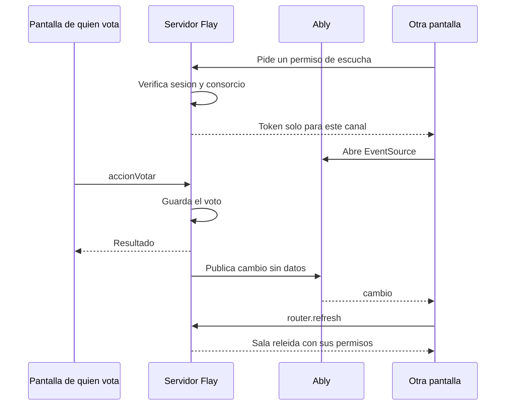

# Sala de asamblea en vivo — diseño

> Estado: para aprobar. Toca FR-023 y SC-001 de `specs/016-asambleas/spec.md` y la decisión R-01 de
> `specs/016-asambleas/research.md`. No toca reglas de negocio.

## Intención

Durante una asamblea, lo que hace una persona tiene que aparecer enseguida en la pantalla de las
demás. Hoy la sala se relee cada 3 s (`EnVivo`, R-01): cumple el mínimo de SC-001 (≤ 5 s), pero en una
reunión se nota la espera. Quien usa el sistema lo pidió así: «si alguien vota, me debería aparecer al
instante también».

Los toques propios ya se reflejan al instante con `useOptimistic`; este diseño no los toca.

## Objetivos

- Un voto, una acreditación o un cambio de punto llegan a las demás pantallas abiertas en alrededor de
  un segundo. Es una meta a medir en la prueba manual, todavía no una cifra medida.
- Si el servicio de tiempo real falla, no está configurado o se llena, la sala sigue funcionando como
  hoy, cada 3 s, sin que nadie tenga que hacer nada.
- Una votación nunca se demora ni falla por culpa del servicio de tiempo real.

## Fuera de alcance

- El resto del sistema: notificaciones, liquidación y carga asistida siguen como están.
- Presencia («quién está mirando»), historial de eventos y envío de datos por el canal.
- Cambiar el bus en memoria de `eventos-notificaciones.ts`.

## Lo que no puede pasar

- Que `ABLY_API_KEY` llegue al navegador: nunca con prefijo `NEXT_PUBLIC_` y nunca versionada.
- Que el canal transporte votos, nombres o cualquier dato de la asamblea.
- Que alguien sin acceso a la asamblea pueda escuchar su canal.

## Cómo funciona

El aviso solo dice «esta asamblea cambió». Cada pantalla relee por el camino de siempre, así que los
permisos, el aislamiento por consorcio (RN-12) y el cómputo siguen en un solo lugar.

### Publicar

- Canal: `asamblea:<asambleaId>`. Mensaje: nombre `cambio`, sin `data`.
- `POST https://main.realtime.ably.net/channels/<canal>/messages`, con `fetch` y autenticación Basic,
  acotado a 2 s.
- Un puerto `AvisoEnVivo` con dos implementaciones: la de Ably y una nula, que se usa cuando falta
  `ABLY_API_KEY`. Se elige en `src/aplicacion/dependencias.ts` (nota 5 de `CLAUDE.md`). La nula es la
  que corren las pruebas y la que hace que la sala funcione sin la clave.
- Se publica dentro de `after()`, una vez confirmada la acción, desde `ejecutarEnSala` y
  `accionFinalizar`. Un error de publicación se registra y se ignora: el voto ya está guardado.
- Una acción rechazada no publica.
- Poderes y oposiciones no publican; los recoge el sondeo de resguardo.

### Permiso de escucha

- `GET /api/asambleas/[asamblea]/en-vivo?consorcio=<id>`.
- Responde 401 sin sesión. Responde 404 si la persona no alcanza esa asamblea o si no está `en_curso`,
  y el permiso se decide con `conAutorizacion`, igual que `verAsamblea`.
- Pide a Ably un token con `POST /keys/<appId.keyId>/requestToken`, autenticación Basic, capacidad
  `{"asamblea:<id>":["subscribe"]}` y vida de 1 h, el valor por omisión.
- Responde 204 si no hay clave configurada: la pantalla queda en sondeo.

### En la pantalla

Un componente `SalaEnVivo` reemplaza a `<EnVivo />` en `[asamblea]/page.tsx`:

- Pide el token y abre `EventSource` contra
  `https://main.realtime.ably.net/sse?v=1.2&channels=<canal>&accessToken=<token>`.
- Al recibir `cambio`, refresca como máximo una vez cada 500 ms. Si llegan avisos durante un refresco,
  hace uno más al terminar. Así, veinte votos seguidos no disparan veinte relecturas.
- Conectado, sondea cada 15 s. Ese sondeo cubre un aviso perdido y mantiene el drenaje de la cola de la
  nota 21.
- Desconectado, sondea cada 3 s, igual que hoy.
- Ante un error de `EventSource`, cierra la conexión, pide un token nuevo y reabre con espera creciente
  de hasta 30 s. Reabrir a mano es obligatorio: el token va en la URL y la reconexión del navegador
  repetiría el vencido.
- Con la pestaña oculta o sin conexión no refresca. Al volver, refresca una vez.

## Decisiones tomadas por el diseño

- **Ably por SSE y no por WebSocket.** Se había hablado de WebSocket. La pantalla solo necesita
  escuchar, y `EventSource` es nativo del navegador: la entrega es igual de directa, no suma el paquete
  `ably` ni peso al cliente, y no obliga a tocar el § 14.1. A cambio, según la documentación de Ably,
  es menos resistente que su SDK ante problemas de red y conserva el estado de conexión solo dos
  minutos. Los dos sondeos cubren eso. Si la prueba manual da mal, cambiar a WebSocket afecta solo a
  `SalaEnVivo`.
- **Sin SDK en el servidor.** Son dos `POST` con `fetch`.
- **Aviso sin datos.** Cuesta una relectura por pantalla, pero evita duplicar en el cliente la lógica
  de permisos y de cómputo.

## Capacidad

Según lo relevado sobre el plan Free: 200 conexiones simultáneas y 6 millones de mensajes por mes.
Cada aviso cuenta una vez al publicarse y una vez por pantalla que lo recibe: 100 votos con 100
pantallas son unos 10.000 mensajes por punto. Si se supera el límite de conexiones, las pantallas que
no entran quedan en sondeo cada 3 s. Antes de desplegar hay que confirmar estos límites en la cuenta.

## Pruebas

- Integración: con un doble de `AvisoEnVivo`, una acción aceptada publica y una rechazada no. Si
  publicar falla, la acción igual termina bien.
- Integración: el permiso de escucha rechaza a quien no tiene sesión y a un usuario de otro consorcio.
- Prueba sin base de datos del refresco acotado: varios avisos seguidos producen dos refrescos como
  máximo.
- Las pruebas de extremo a extremo no cambian: corren sin clave, por sondeo.
- Prueba manual con la clave real y dos navegadores: medir de voto a pantalla ajena, cortar la red y
  volver, y comprobar en el navegador que la clave no aparece en ninguna respuesta.

## Documentación

- `.env.example`: `ABLY_API_KEY=` vacía, con un comentario.
- `specs/016-asambleas/research.md`: reescribir R-01.
- `docs/entrega-final/14-codificacion.md`: declarar el servicio. No hay dependencia nueva.
- `docs/entrega-3/`: sin nombres de producto. Si hace falta mencionarlo, «servicio de mensajería en
  tiempo real».

## Queda para quien construya

- Nombres de archivos y de funciones.
- Dónde vive el refresco acotado, siempre que se pueda probar sin navegador.
- La curva exacta de reintentos, con tope de 30 s.
